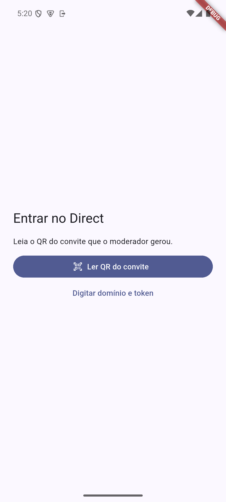
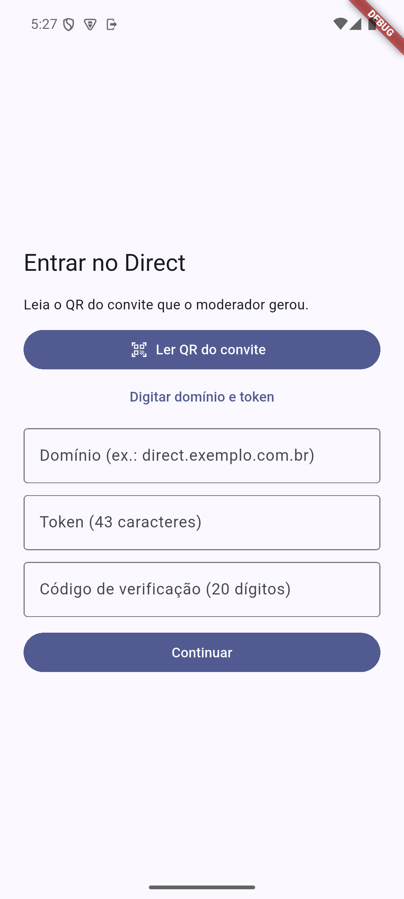
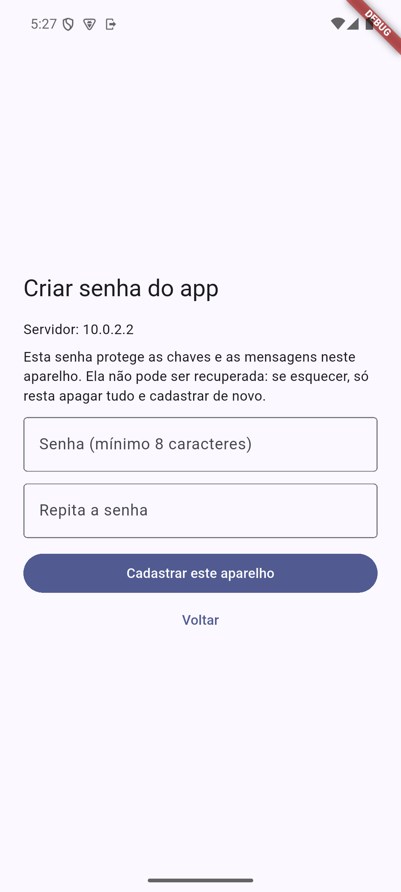
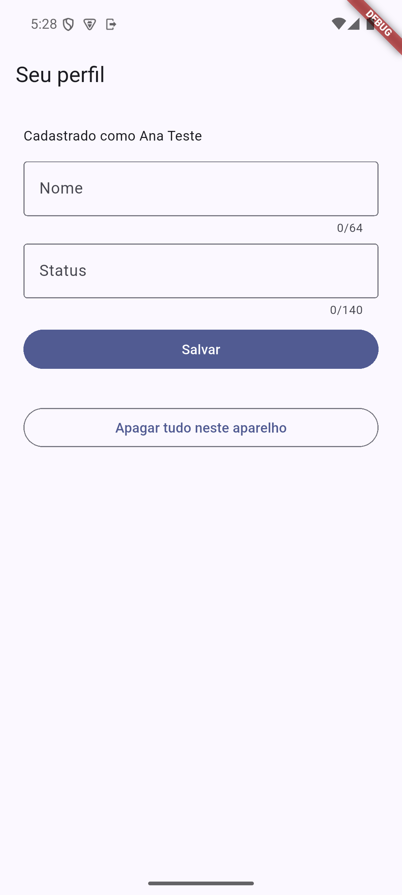
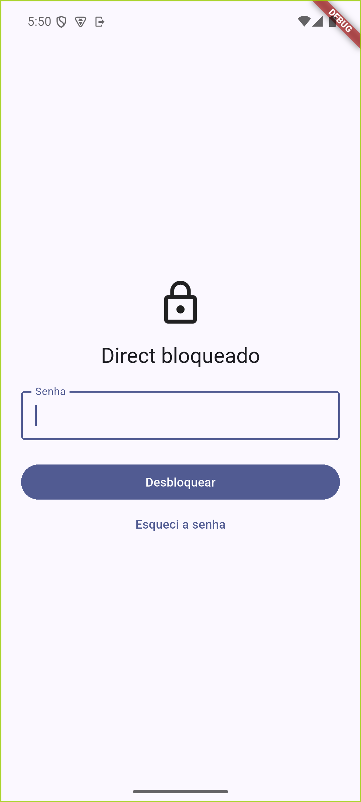
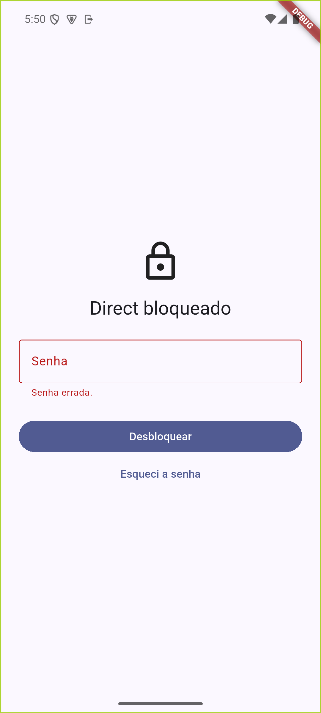
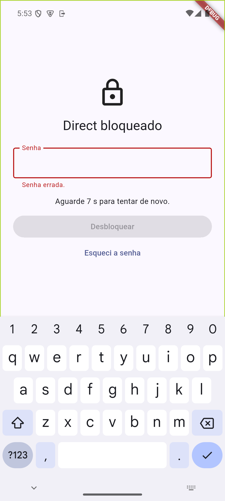
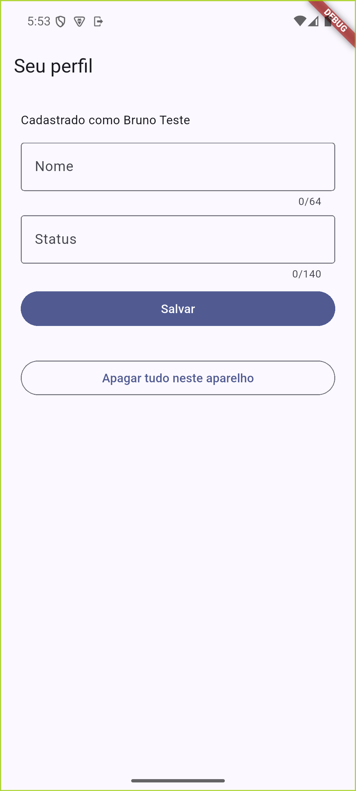

# Direct: fluxos do app base (F4)

Prints tirados em 24/11/2026, build de debug, emulador Android API 35, contra o `directd` local.
Mostram o app como estava ao fim da F4; fases posteriores podem ter mudado telas.
Referências: `docs/PLANO.md` (seção 6) e `docs/protocolo.md` na raiz do repositório.

## 1. Cadastro

```
QR do convite ─────────────────────────┐
domínio + token + código de 20 dígitos ┴─> criar senha ─> POST /v1/enroll ─> perfil
```

### 1.1 Entrada

O usuário lê o QR do convite ou digita os dados. A leitura por câmera não foi testada no emulador.



### 1.2 Entrada manual

Domínio, token (43 caracteres) e código de verificação. O app chama `GET /v1/server-info`,
calcula o código com as chaves recebidas e só continua se for igual ao digitado.



### 1.3 Criar a senha do app

Mínimo de 8 caracteres, digitada duas vezes. Ao confirmar, o app:

1. Gera as chaves Ed25519 e X25519 do aparelho.
2. Envia `POST /v1/enroll`, assinado pelo convite e pelo aparelho.
3. Confere o certificado com a chave do servidor fixada no convite. Se não bater, nada é gravado.
4. Cria a chave-mestra, protegida pela senha (Argon2id). Ela abre o banco SQLCipher e as chaves privadas.



## 2. Perfil e login

Nome (1 a 64 caracteres) e status (até 140). Ao salvar, o app faz o login por desafio
(`/v1/auth/challenge` e `/v1/auth/verify`) e envia `PUT /v1/me/profile`.



## 3. Trava por senha

O app tranca ao abrir e ao ir para segundo plano. Ao trancar, fecha o banco e esquece a chave-mestra.



### 3.1 Senha errada e atraso crescente



| Erros seguidos | Espera |
|----------------|--------|
| 1 e 2 | nenhuma |
| 3 | 5 s |
| 4 | 10 s |
| 5 | 20 s |
| 6 em diante | dobra até o limite de 15 min |

Durante a espera o botão fica desativado, e nem a senha certa entra.



### 3.2 Desbloqueio

A senha certa zera a contagem e volta ao perfil. Este print é de um cadastro em que o perfil
ainda não tinha sido salvo, por isso os campos estão vazios.



## 4. Esqueci a senha e apagar tudo

Sem print.

1. Na tela de bloqueio, "Esqueci a senha" explica que a senha não se recupera.
2. "Apagar tudo neste aparelho" pede confirmação.
3. O app apaga banco, chaves e Keychain/Keystore e volta ao cadastro.
4. O moderador revoga o aparelho antigo e gera um convite novo.

O mesmo botão existe na tela de perfil.

## 5. Revogação

Sem print. Se o login responder `device_revoked` com uma prova assinada pela chave do servidor
fixada no cadastro, o app apaga tudo. Sem prova válida, mantém os dados. A prova válida é coberta
por teste automatizado.

## 6. Limites conhecidos

- O atraso da trava usa o relógio do aparelho.
- Não testados no emulador: leitura do QR, "Esqueci a senha", revogação e a tecla Enter do teclado real.
- No debug, o host `10.0.2.2` usa HTTP para falar com o `directd` local. Em release é sempre HTTPS.
